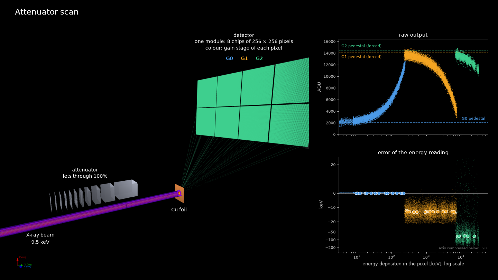
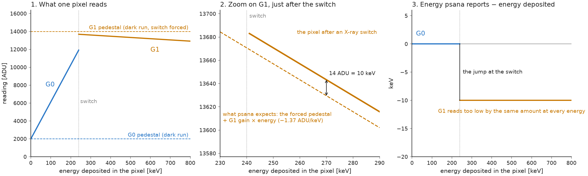
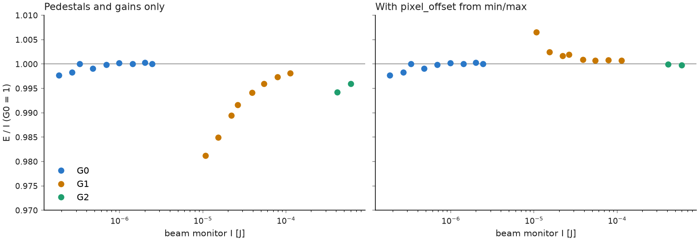

# Detector calibration



*Simulated attenuator scan. [Animation](https://drive.google.com/file/d/1ooFNBPKVZZrrimxJ8sOoEsuyy4qFa7-g/view?usp=sharing)*

This repository simulates an attenuator scan with the JUNGFRAU detector at MFX.

We use it to develop methods for measuring the detector's gain-switching offsets. In the
simulator we know the true offsets, which lets us test a method before trying it on real
data. The attenuator, the DAQ, MFX's `attenuator_scan` and psana's `DataSource` are called
the same way as at the beamline, and code written here runs there too.

## Background

A JUNGFRAU pixel has three gain stages. The pixel starts every pulse in G0, and as charge
builds up it switches to G1 and then to G2.

The pixel outputs a raw number in ADU, and psana turns it into the calibrated energy `E`
with

```
E = (ADU − P[g]) / G[g]
```

Here `g` is the stage the pixel ended up in. The pedestal `P[g]` is what the pixel outputs
in that stage with no X-rays, and the gain `G[g]` is how much the output changes per keV.
Each stage has its own pedestal and gain.

The gains come from a separate calibration and get loaded with psana's other constants. The
pedestals are measured during the beamtime in a dark run. Without X-rays a pixel never
leaves G0, so the dark run forces the pixels into G1 and G2 to get those pedestals too.

## Gain-switching offsets

As reported by [Sikorski et al.](https://doi.org/10.3389/fphy.2023.1303247), when X-rays
switch a pixel into G1 during a pulse, its raw output is shifted from the value expected
from the forced pedestal. The same shift is observed in G2.



The figure follows one simulated pixel as more and more energy is deposited in it.

On the left is the raw output. It starts at the G0 pedestal and rises with energy. At the
switch it jumps up to around the forced G1 pedestal and then slowly comes down, because the
G1 gain is negative. This jump is normal. G1 has its own pedestal and gain.

The middle panel zooms in on G1 right after the switch. The dashed line is the forced
pedestal plus the G1 gain times the energy, which is what the conversion assumes. The solid
line is what the pixel actually outputs. They're parallel but `14 ADU` apart, and that gap
is the offset.

On the right is the calibrated energy minus the energy that was really deposited. We only
know the deposited energy because the pixel is simulated. In G0 the difference is `0`. In G1
the `14 ADU` gap works out to `10 keV` at the G1 gain of `−1.37 ADU/keV`, so every energy in
G1 comes out `10 keV` too low and the curve jumps at the switch.

psana can correct for this with a third set of constants, `pixel_offset`, holding one value
`O` per pixel and gain stage. With it the conversion becomes

```
E = (ADU − P[g] − O[g]) / G[g]
```

This project is about learning `O` for every pixel in G1 and G2. The simulator uses offsets
of `10 keV` in G1, close to what [NoGainNoPain](https://github.com/lcls-mlcv/NoGainNoPain)
measured from attenuation scans at MFX (runs `169` and `170` of `mfx100848724`), and `100
keV` in G2, which is our guess.

## Measuring and checking the offsets at the beamline

The data comes from MFX's `attenuator_scan`. It moves the attenuator through a list of
transmissions, here from `3·10⁻⁴` up to `1`, and every pixel goes through G0, G1 and G2
along the way. The DAQ runs for the whole scan and records the detector images and the
reading of the beam monitor at DG2 for every pulse.

To check a set of offsets, we'd like to compare the calibrated energy with the energy the
pixel really got. In the simulator we know it, and that's how the plots above were made. On
a real detector we don't, so we need something else to compare against.

For that we use the beam monitor at DG2. It sits after the attenuator and measures the
energy of each pulse in joules
(`run.Detector("MfxDg2BmMon").raw.totalIntensityJoules(evt)`). We call its reading `I`.
Averaged over pulses, the energy in the pixel is proportional to it

```
E_true = k × I
```

Here `k` is the energy the pixel gets per joule of `I`. We don't know `k`. It depends on the
foil, the geometry and where the pixel sits.

But we can measure it in G0. The G0 pedestal is measured without forcing, in the same state
the pixel is in when X-rays hit it. So the calibrated energy in G0 is right without any
offset, and it gives us

```
k = E / I
```

G1 and G2 can't be used for this. Their pedestals are forced, and they're the stages we want
to check.

`k` doesn't change when more beam pushes the pixel into G1 and G2. The gain stage changes
how the pixel turns energy into a raw number, not how much energy arrives. With a correct
calibration `E / I` stays at `k` all the way up. If instead the calibrated energy in G1 is
off by `ΔE`, with `E = E_true − ΔE`, then

```
E / I = k − ΔE / I
```

and the ratio moves away from `k` by `ΔE / I`. That's biggest right after the switch, where
`I` is smallest. The sign of `ΔE` isn't known in advance, but in the simulator, as at MFX,
the energy in G1 comes out too low and the ratio drops below `k`. After a correction `E / I`
should be flat across both switches, which is one way we could check if our offsets work on
real data.



The figure shows `E / I` along a simulated scan, divided by `k` so that G0 sits at `1`. On
the left the conversion uses only the pedestals and gains, and G1 and G2 sit below `1`. On
the right it also applies offsets from min/max, and G1 and G2 come back up to `1`. The beam
monitor is perfect here. The simulator can also add noise to it, which makes the ratio less
precise.

Min/max is our baseline, from [NoGainNoPain](https://github.com/lcls-mlcv/NoGainNoPain). For
each pixel it takes the highest calibrated energy in G0 and the lowest in G1. Both should be
close to the switching energy, and the difference between them is the G1 offset. The switch
from G1 to G2 works the same way. Because it only looks at these extremes, its result
depends on the noise and on how many pulses land near the switch.

## Where to start

To install the simulator, run

```bash
cd detector_calibration
uv venv --python 3.11 && source .venv/bin/activate
uv pip install -e ".[dev]"
```

After that, try going through the quickstart notebook (`jupyter lab
notebooks/01_quickstart.ipynb`). It shows how to move the attenuator, take data, read it
back, and write and score an offset method. Then you can write your own method in
`protocols/my_method.py` and compare it with min/max using `python scripts/compare.py`. It
scores every method in `protocols` against the simulator's true offsets.
